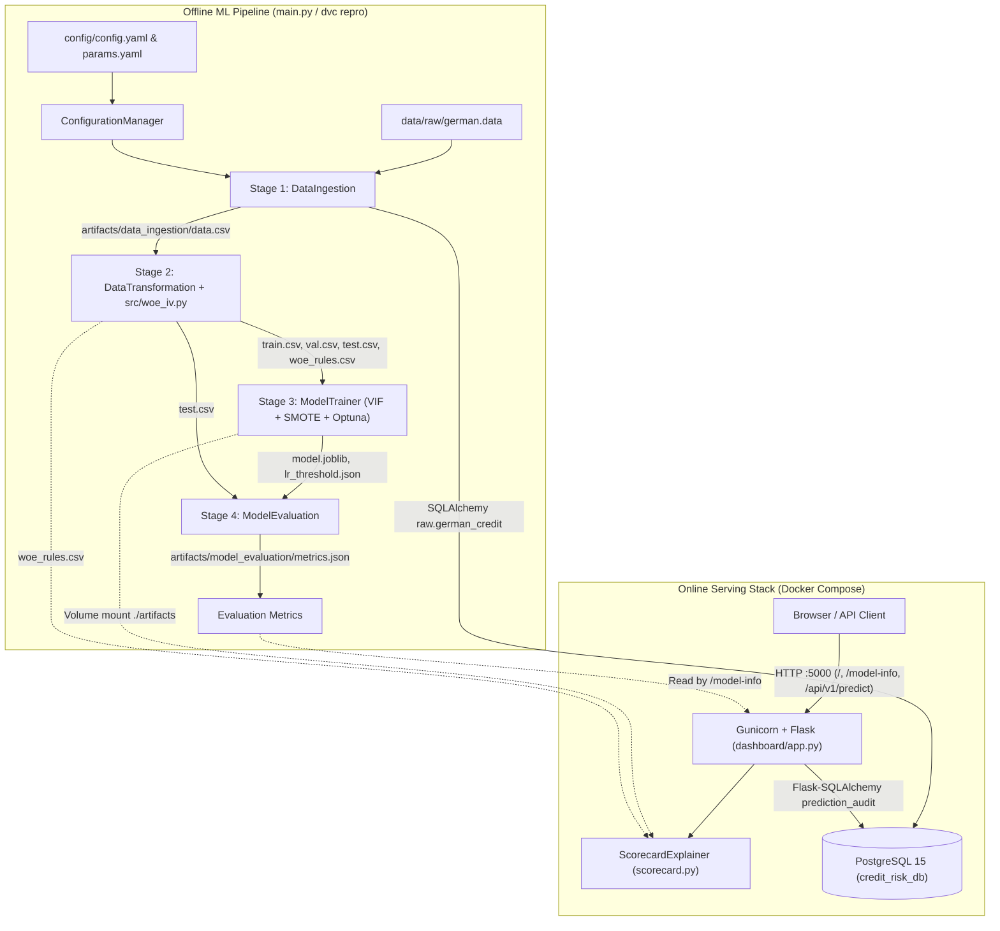
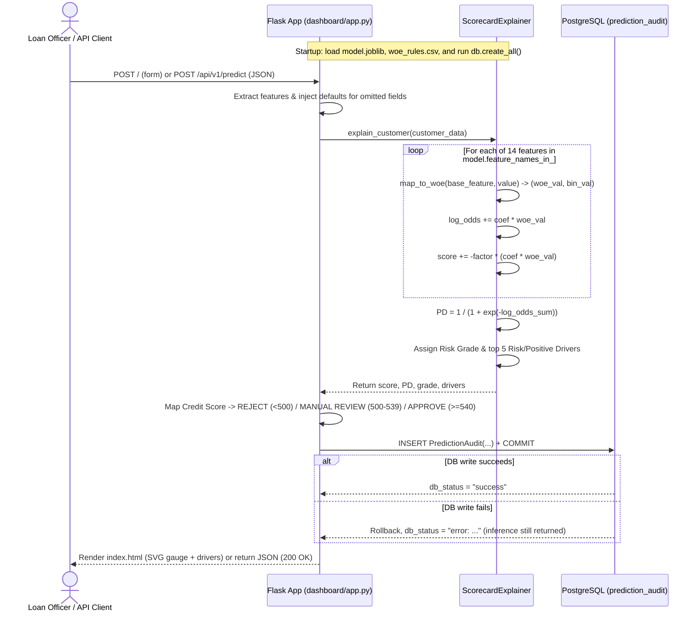

# Customer Risk Intelligence (`Customer_Risk`) — Project Overview

## 1. Executive Summary

**Customer Risk Intelligence** (packaged as `CustomerRiskPrediction` / `customer-risk` v0.1.0) is an end-to-end credit risk scoring and default prediction platform built on the **Statlog (German Credit Data)** dataset (`data/raw/german.data`, 1,000 loan applications). It solves the core underwriting problem of translating raw applicant financial and demographic attributes into **interpretable, regulatory-style credit scores**, **probability of default (PD)** estimates, **feature-level score explanations (XAI)**, and **auditable lending decisions** (`APPROVE`, `MANUAL REVIEW`, `REJECT`).

The system operates across two decoupled workflows sharing serialized pipeline artifacts and a PostgreSQL database:

1. **Offline Training & Evaluation Pipeline** (`main.py`, `dvc.yaml`, `src/CustomerRiskPrediction/`):
   - Ingests raw space-delimited credit records into PostgreSQL (`raw.german_credit`) and local CSV storage (`artifacts/data_ingestion/data.csv`).
   - Splits data into stratified train/validation/test sets (`700 / 150 / 150`), discretizes `age` and `duration`, calculates **Weight of Evidence (WOE)** and **Information Value (IV)** on the training split (`src/woe_iv.py`), and filters features with `IV >= 0.02` (retaining 14 features).
   - Prunes multicollinear features iteratively using **Variance Inflation Factor (VIF <= 5.0)**, balances classes via **SMOTE**, tunes an ElasticNet **Logistic Regression** classifier (`solver="saga"`) over 50 **Optuna** trials (5-fold CV ROC-AUC), optimizes a binary classification threshold via **F2-score** (`0.25`), and evaluates holdout test metrics (`artifacts/model_evaluation/metrics.json`).
2. **Online Inference Dashboard & REST API** (`dashboard/app.py`):
   - Loads `artifacts/model_trainer/model.joblib` and `artifacts/data_transformation/woe_rules.csv` into `ScorecardExplainer` (`src/CustomerRiskPrediction/components/scorecard.py`).
   - Converts logistic regression log-odds into a points-based credit scorecard (`base_score=600`, `base_odds=50:1`, `pdo=20`), computes additive per-feature score contributions (top 5 risk drivers and top 5 positive drivers), assigns a 5-tier risk grade and underwriting decision, persists an audit record to PostgreSQL (`prediction_audit`), and serves both a dark-mode Flask/Jinja2 web UI (`/`, `/model-info`) and a headless JSON endpoint (`POST /api/v1/predict`).

---

## 2. Tech Stack & Dependencies — What We Used and Why

> **Note on Rationale Attribution:** Where rationales are explicitly stated in repository documentation or comments (e.g., `README.md`, `dashboard/templates/model_info.html`, inline code comments), they are marked **Documented**. Where rationales are deduced from code usage and library capabilities, they are marked **Inferred**.

| Category | Tool / Library (Pinned / Observed Version) | Where It Is Used | Why It Is Used & Rationale |
| :--- | :--- | :--- | :--- |
| **Language** | Python (`3.10-slim` in `Dockerfile` & CI; `>=3.12.13` in `pyproject.toml`, `.python-version`) | Entire codebase | Primary language for tabular ML, pipeline scripting, and Flask web serving (**Inferred**). Note: runtime version drift exists between local/metadata (`3.12.13`) and container/CI (`3.10`). |
| **Data Manipulation** | `pandas` (installed `3.0.5`), `numpy` (installed `2.5.2`) | `src/woe_iv.py`, `components/*.py`, `research/` | Tabular ingestion, binning (`pd.cut`, `pd.qcut`), groupby WOE/IV aggregations, and vectorized scorecard arithmetic (**Inferred**). |
| **ML & Preprocessing** | `scikit-learn` (installed `1.9.0`) | `data_transformation.py`, `model_trainer.py`, `model_evaluation.py` | Stratified `train_test_split`, `LogisticRegression` (ElasticNet with `saga`), `cross_val_score`, and evaluation metrics (`roc_auc_score`, `fbeta_score`, etc.) (**Documented** in `model_info.html` for linear interpretability on WOE features). |
| **Imbalance Handling** | `imbalanced-learn` (`SMOTE`, installed `0.14.2`) | `model_trainer.py` (`SMOTE(random_state=42)`) | Synthetic oversampling of minority default cases from 700 to 980 training samples (**Documented** in `model_trainer.py` logs: "handling class imbalance"). *Missing from `requirements.txt`.* |
| **Hyperparameter Tuning** | `optuna` (installed `4.9.0`) | `model_trainer.py` (50-trial study) | Bayesian/TPE search over `C`, `l1_ratio`, and `class_weight` maximizing 5-fold CV ROC-AUC (**Inferred**). *Missing from `requirements.txt`.* |
| **Multicollinearity Check** | `statsmodels` (installed `0.14.6`) | `model_trainer.py` (`variance_inflation_factor`, `add_constant`), `research/02_preprocessing_eda.ipynb` | Iterative VIF pruning (`VIF > 5.0`) to keep linear scorecard coefficients stable (**Documented** in `model_trainer.py` comments/logs). *Missing from `requirements.txt`.* |
| **Serialization** | `joblib` (installed `1.5.3`) | `utils/common.py`, `model_trainer.py`, `model_evaluation.py`, `scorecard.py` | Serializing and loading the trained scikit-learn `LogisticRegression` artifact (`model.joblib`) (**Inferred**). |
| **Web Framework & WSGI** | `Flask` (`3.1.3`), `Jinja2` (`3.1.6`), `gunicorn` | `dashboard/app.py`, `dashboard/templates/*.html`, `Dockerfile` | Lightweight synchronous HTTP server for Jinja2 HTML rendering and `POST /api/v1/predict` JSON inference; Gunicorn provides the production WSGI server (**Documented** in `Dockerfile` & `README.md`). |
| **Database & ORM** | PostgreSQL (`postgres:15-alpine`), `SQLAlchemy` (`2.0.51`), `Flask-SQLAlchemy` (`3.1.1`), `psycopg2-binary` (`2.9.12`) | `docker-compose.yml`, `data_ingestion.py`, `dashboard/app.py` | Persists ingested raw dataset (`raw.german_credit`) and real-time inference audit logs (`prediction_audit`) (**Documented** in `README.md` & `dashboard/app.py`). |
| **Config & Validation** | `PyYAML` (`6.0.3`), `python-box` (`6.0.2`), `ensure` (`1.0.2`), `python-dotenv` (`1.2.2`) | `utils/common.py`, `configuration.py`, `data_ingestion.py`, `dashboard/app.py` | Dot-notation attribute access over YAML configs (`ConfigBox`), runtime type-annotation enforcement (`@ensure_annotations`), and `.env` credential loading (**Inferred**). |
| **Data & Pipeline Versioning** | `dvc` (`3.67.1`) | `dvc.yaml`, `dvc.lock`, `.dvc/` | Reproducible 4-stage DAG tracking MD5 hashes of scripts, `config.yaml`, `params.yaml`, and output artifacts (**Inferred**; `.dvc/config` is empty, so local cache only). |
| **Frontend Styling & Assets** | HTML5, Vanilla CSS3, inline SVG, Google Fonts (`Inter`) | `dashboard/templates/*.html`, `dashboard/static/css/style.css`, `assets/hero-radar.svg` | "Midnight Tech" dark-mode UI with animated SVG semi-circular credit score gauge and zero-build-step frontend (**Documented** in `style.css` & `README.md`). |
| **Containerization & CI/CD** | Docker, Docker Compose, GitHub Actions (`flake8`, `appleboy/ssh-action`), AWS EC2 | `Dockerfile`, `docker-compose.yml`, `.github/workflows/main.yml` | Reproducible multi-container local/EC2 deployment (`credit_risk_db` + `credit_risk_web`), syntax/lint checks, and SSH-based deployment to EC2 with 1 GB swap creation (**Documented** in `main.yml` & `README.md`). |
| **EDA & Visualization** | `matplotlib` (`3.11.1`), `seaborn` (`0.13.2`), `tqdm` (`4.70.0`), Jupyter | `research/02_preprocessing_eda.ipynb`, `requirements.txt` | Exploratory data analysis and distribution plotting during research (**Inferred**; not used by production inference). |

---

## 3. Capabilities & Scope — What It Does vs. What It Does NOT Do

### What It Does (Implemented & Verified)

- **Automated Raw Data Ingestion (`DataIngestion.download_data`)**: Parses the headerless whitespace-delimited `data/raw/german.data` file into 21 named columns, remaps target `credit_risk` (`1 -> 0` Good, `2 -> 1` Bad), creates the `raw` PostgreSQL schema if needed, writes rows to `raw.german_credit`, and exports `artifacts/data_ingestion/data.csv`.
- **Stratified Splitting & WOE/IV Feature Engineering (`DataTransformation.perform_transformation`)**: Splits data 70% train / 15% validation / 15% test stratified by `credit_risk` (`random_state=42`); bins `age` into 5 fixed brackets (`18-25`, `26-35`, `36-45`, `46-55`, `56+`) and `duration` into 5 training-derived quantiles (`pd.qcut`); calculates WOE and IV with $\epsilon = 10^{-6}$ smoothing (`src/woe_iv.py`); retains features with `IV >= 0.02` (14 of 15 candidate features); and saves `train.csv`, `val.csv`, `test.csv`, and `woe_rules.csv`.
- **Automated Feature Pruning, Oversampling & Model Tuning (`ModelTrainer.train`)**: Iteratively drops WOE features with `VIF > 5.0` (all 14 pass in the current dataset), applies `SMOTE` on the training set (700 -> 980 rows), runs 50 Optuna trials of ElasticNet `LogisticRegression(solver='saga')` optimizing 5-fold CV ROC-AUC, saves `model.joblib`, and sweeps thresholds `0.10..0.90` to maximize F2-score (`lr_threshold.json` = `0.25`).
- **Holdout Test Evaluation (`ModelEvaluation.save_results`)**: Scores `artifacts/data_transformation/test.csv` (150 rows) using `model.joblib` and `lr_threshold.json`, exporting `ROC_AUC` (`0.8057`), `Gini` (`0.6114`), `PR_AUC` (`0.6207`), `Log_Loss` (`0.5187`), `Brier_Score` (`0.1730`), `Precision` (`0.4141`), `Recall` (`0.9111`), `F1_Score` (`0.5694`), and confusion matrix (`TN: 47, FP: 58, FN: 4, TP: 41`) to `artifacts/model_evaluation/metrics.json`.
- **Scorecard Scaling & Additive XAI Attribution (`ScorecardExplainer`)**: Scales logistic regression log-odds using `Base Score = 600`, `Base Odds = 50:1`, `PDO = 20` (`Factor = 28.8539`, `Offset = 487.1229`). Decomposes each prediction into per-feature point contributions (`-Factor * coef * WOE`), returns the top 5 negative (`Risk Drivers`) and top 5 positive (`Positive Drivers`) contributors, and assigns one of 5 risk grades (`Very Low Risk` >= 560, `Low Risk` 530–559, `Moderate Risk` 500–529, `High Risk` 460–499, `Very High Risk` < 460).
- **Web Dashboard & Underwriting Rules (`dashboard/app.py`, `index.html`, `model_info.html`)**:
  - `GET/POST /`: Renders an interactive applicant form (9 inputs) and displays the SVG score gauge, PD%, risk grade, decision (`< 500` -> `REJECT`, `500–539` -> `MANUAL REVIEW`, `>= 540` -> `APPROVE`), PostgreSQL audit status, and feature-contribution bar charts.
  - `GET /model-info`: Displays holdout metrics and the confusion matrix read from `artifacts/model_evaluation/metrics.json`.
- **Headless Scoring API (`POST /api/v1/predict`)**: Accepts JSON applicant payloads, applies defaults for omitted features, computes scorecard/decision outputs, writes an audit row to PostgreSQL, and returns JSON containing `status`, `db_status`, `credit_score`, `probability_of_default`, `risk_grade`, `decision`, and `features_used`.
- **PostgreSQL Inference Audit Logging (`PredictionAudit`)**: Persists `timestamp`, `age`, `credit_amount`, `duration`, `credit_score`, `prob_default`, `decision`, and `risk_grade` to `prediction_audit` on every web or API prediction.

### What It Does NOT Do (Explicit Boundaries & Non-Goals)

- **No Authentication, Authorization, or Multi-Tenancy**: Neither the Flask UI nor `/api/v1/predict` has API keys, user sessions, RBAC, CSRF tokens, or rate limiting.
- **No Automated Test Suite**: There is no `tests/` directory, unit test, integration test, or API contract test in the repository; CI only executes `flake8` and `docker build`.
- **No Audit Log Viewing, Export, or Feedback Loop**: Predictions are written to `prediction_audit`, but there is no UI route, API endpoint, or batch job to query past predictions, record actual loan outcomes, or trigger model retraining.
- **Unused Numerical Attributes & Partial Web Form Coverage**:
  - `credit_amount`, `installment_rate`, `residence_since`, `existing_credits`, and `dependents` are **never used by the trained model** (only categorical columns plus binned `age` and `duration` enter `candidate_features` in `data_transformation.py`). Even though the UI and API accept `credit_amount` and store it in `prediction_audit`, `ScorecardExplainer` ignores it.
  - The HTML form in `dashboard/templates/index.html` collects 9 fields and exposes only 5 of the 10 `purpose` codes (`A40`, `A41`, `A42`, `A43`, `A49`). Six required model features (`personal_status_sex`, `other_debtors`, `property`, `other_installment_plans`, `job`, `foreign_worker`) are silently hardcoded to defaults in `dashboard/app.py` during UI submissions (though overridable via JSON on `/api/v1/predict`).
- **No Strict Input Validation or Out-of-Range Rejection**: Missing/unknown categories or out-of-range numeric values (e.g., `age < 18`, `duration <= 3.999` or `> 60`) silently map to `WOE = 0.0` (`bin = "Unknown"`) in `ScorecardExplainer.map_to_woe()` rather than raising a validation error. Non-numeric inputs raise uncaught exceptions (`500` in `/api/v1/predict`, unhandled server error in `/`).
- **No Remote Model/Data Storage Configured**: `.dvc/config` is empty (0 bytes); DVC tracks artifacts only in the local `.dvc/cache`, and `docker-compose.yml` bind-mounts `./artifacts:/app/artifacts`.
- **No Active Challenger / Ensemble Models in Production Code**: Although `artifacts/model_trainer/.gitignore` and historical entries in `logs/running_logs.log` reference XGBoost, CatBoost, and Stacking models, the current codebase trains and serves **only** ElasticNet Logistic Regression (`model.joblib`).
- **No Working Calibration Report Script**: `research/03_scorecard_calibration.py` imports a removed `ScorecardBuilder` class and cannot execute against the current `scorecard.py`.
- **Operational Assumptions**:
  - Importing `dashboard/app.py` executes `db.create_all()` at module load time, assuming PostgreSQL is already up and reachable (enforced in Docker via `depends_on: db: condition: service_healthy`, but will crash local startup if Postgres is stopped).
  - Running `main.py` or `dvc repro` assumes execution from the repository root (`constants/__init__.py` uses relative `Path("config/config.yaml")` and `Path("params.yaml")`).

---

## 4. System Architecture & Data/Execution Flow

The repository implements a **two-tier modular architecture**:
1. **Batch ML Pipeline (DVC-Orchestrated Monolith)**: Configuration-driven stages (`ConfigurationManager` -> `Pipeline` stage wrapper -> `Component` class) reading YAML configs and writing CSV/Joblib/JSON artifacts to `artifacts/`.
2. **Synchronous Web & API Monolith (`dashboard/app.py`)**: A Gunicorn-hosted Flask application loading serialized artifacts once at startup, running in-process scorecard inference, and committing audit rows to a containerized PostgreSQL 15 database.

### System Architecture Diagram



### Core Execution / Data Flow Diagram



### Execution Lifecycle Walkthrough

1. **Training Lifecycle (`python main.py` or `dvc repro`)**:
   - `main.py` sequentially instantiates and calls `.main()` on `DataIngestionTrainingPipeline`, `DataTransformationTrainingPipeline`, `ModelTrainerTrainingPipeline`, and `ModelEvaluationTrainingPipeline`.
   - Each pipeline wrapper creates a `ConfigurationManager` (reading `config/config.yaml` and `params.yaml` via `read_yaml`), constructs a frozen dataclass config entity (`config_entity.py`), and invokes the corresponding component (`download_data()`, `perform_transformation()`, `train()`, `save_results()`).
2. **Inference Lifecycle (`gunicorn --bind 0.0.0.0:5000 dashboard.app:app`)**:
   - On module import, `dashboard/app.py` loads `.env`, configures SQLAlchemy against PostgreSQL, initializes a global `ScorecardExplainer` from `artifacts/model_trainer/model.joblib` and `artifacts/data_transformation/woe_rules.csv`, and runs `db.create_all()`.
   - Requests to `POST /` or `POST /api/v1/predict` normalize input dictionaries with defaults, invoke `explainer.explain_customer(customer_data)`, apply score-based underwriting cutoffs (`500`, `540`), persist a `PredictionAudit` row (with `db.session.rollback()` on DB failure so scoring degrades gracefully), and return either rendered HTML or JSON.

---

## 5. Complete Project Structure

### Directory Tree

*(Excludes `.git/`, `.venv/`, `__pycache__/`, `.dvc/cache/`, and `.dvc/tmp/`.)*

```text
Customer_Risk/
├── .dvc/
│   ├── .gitignore                         # DVC-generated ignores for local cache/tmp
│   └── config                             # Empty DVC config (no remote configured)
├── .github/
│   └── workflows/
│       ├── .gitkeep                       # Scaffold placeholder from template.py
│       └── main.yml                       # GitHub Actions CI (flake8 + docker build) & CD (AWS EC2 SSH)
├── artifacts/
│   ├── data_ingestion/
│   │   ├── .gitignore                     # Ignores /data.csv for git (DVC-tracked)
│   │   └── data.csv                       # Ingested 1,000-row dataset with mapped binary target
│   ├── data_transformation/
│   │   ├── .gitignore                     # Ignores train.csv, val.csv, test.csv, woe_rules.csv
│   │   ├── test.csv                       # 150-row holdout test split with WOE columns
│   │   ├── train.csv                      # 700-row training split with WOE columns
│   │   ├── val.csv                        # 150-row validation split with WOE columns (currently unused)
│   │   └── woe_rules.csv                  # 62 WOE/IV bin rules across 14 retained features
│   ├── model_evaluation/
│   │   ├── .gitignore                     # Ignores /metrics.json
│   │   └── metrics.json                   # Holdout test evaluation metrics & confusion matrix
│   └── model_trainer/
│       ├── .gitignore                     # Ignores model.joblib, lr_threshold.json & legacy model files
│       ├── lr_threshold.json              # F2-optimal probability threshold (0.25)
│       └── model.joblib                   # Trained ElasticNet LogisticRegression model
├── assets/
│   └── hero-radar.svg                     # Animated SVG radar graphic embedded in README.md
├── config/
│   └── config.yaml                        # Artifact paths, raw source path, and DB table name
├── dashboard/
│   ├── static/
│   │   └── css/
│   │       └── style.css                  # "Midnight Tech" dark-mode theme & gauge/bar animations
│   ├── templates/
│   │   ├── index.html                     # Risk assessment form, SVG gauge & XAI driver breakdown
│   │   └── model_info.html                # Model metrics, confusion matrix & methodology page
│   └── app.py                             # Flask web server, REST API (/api/v1/predict) & ORM audit model
├── data/
│   └── raw/
│       └── german.data                    # Raw UCI Statlog German Credit dataset (1,000 rows, space-delimited)
├── logs/
│   └── running_logs.log                   # Persistent pipeline execution logs
├── research/
│   ├── 02_preprocessing_eda.ipynb         # EDA, train/val/test split, WOE/IV & VIF exploration notebook
│   ├── 03_scorecard_calibration.py        # Legacy calibration report generator (imports removed ScorecardBuilder)
│   ├── Scorecard_Report.md                # Legacy report generated by 03_scorecard_calibration.py
│   └── trials.ipynb                       # Empty 0-byte notebook created by template.py
├── src/
│   ├── CustomerRiskPrediction/
│   │   ├── __init__.py                    # Package marker
│   │   ├── exception.py                   # CustomException formatting script filename & line number
│   │   ├── logger.py                      # Shared Rotating/File+Stdout logger ("CustomerRiskPredictionLogger")
│   │   ├── components/
│   │   │   ├── __init__.py                # Package marker
│   │   │   ├── data_ingestion.py          # Stage 1 component: raw parse, Postgres upload, CSV export
│   │   │   ├── data_transformation.py     # Stage 2 component: stratified split, binning, WOE/IV transform
│   │   │   ├── model_evaluation.py        # Stage 4 component: test-set scoring & metrics.json generation
│   │   │   ├── model_trainer.py           # Stage 3 component: VIF pruning, SMOTE, Optuna LR, F2 threshold
│   │   │   └── scorecard.py               # ScorecardExplainer: log-odds-to-score scaling & XAI attribution
│   │   ├── config/
│   │   │   ├── __init__.py                # Package marker
│   │   │   └── configuration.py           # ConfigurationManager mapping YAML to config dataclasses
│   │   ├── constants/
│   │   │   └── __init__.py                # CONFIG_FILE_PATH & PARAMS_FILE_PATH constants
│   │   ├── entity/
│   │   │   ├── __init__.py                # Package marker
│   │   │   └── config_entity.py           # Frozen dataclasses for each pipeline stage's config
│   │   ├── pipeline/
│   │   │   ├── __init__.py                # Package marker
│   │   │   ├── stage_01_data_ingestion.py # CLI/DVC entrypoint for Stage 1
│   │   │   ├── stage_02_data_transformation.py # CLI/DVC entrypoint for Stage 2
│   │   │   ├── stage_03_model_trainer.py  # CLI/DVC entrypoint for Stage 3
│   │   │   └── stage_04_model_evaluation.py # CLI/DVC entrypoint for Stage 4
│   │   └── utils/
│   │       ├── __init__.py                # Package marker
│   │       └── common.py                  # YAML/JSON/Joblib I/O and directory helpers
│   ├── customer_risk.egg-info/            # Editable install metadata generated by setuptools
│   └── woe_iv.py                          # Core calculate_woe_iv() and transform_to_woe() functions
├── templates/
│   └── index.html                         # Empty 0-byte template placeholder created by template.py
├── .dockerignore                          # Excludes venvs, .git, .dvc, data/, logs/, .env from Docker context
├── .dvcignore                             # Empty template DVC ignore file
├── .env                                   # Local PostgreSQL environment variables (committed)
├── .gitignore                             # Ignores Python build caches, .venv, and cv_bullet_points.md
├── .python-version                        # Specifies Python 3.12.13
├── Customer Risk.gif                      # Demo screen recording embedded in README.md (~21 MB)
├── cv_bullet_points.md                    # Portfolio/resume bullet points summarizing the project
├── docker-compose.yml                     # Multi-container orchestration (postgres:15-alpine + Flask web)
├── Dockerfile                             # python:3.10-slim image installing requirements.prod.txt + Gunicorn
├── dvc.lock                               # DVC lockfile recording MD5 hashes of pipeline stages & artifacts
├── dvc.yaml                               # 4-stage DVC pipeline definition
├── main.py                                # Sequential Python runner for all 4 ML pipeline stages
├── params.yaml                            # Hyperparameter config (loaded by ConfigurationManager)
├── pyproject.toml                         # PEP 621 metadata (customer-risk 0.1.0, requires-python >=3.12.13)
├── README.md                              # Project documentation, live demo badges & setup guide
├── requirements.prod.txt                  # Lean runtime dependencies for Docker container
├── requirements.txt                       # Full development dependencies (includes -e .)
├── setup.py                               # Setuptools build script exposing src/CustomerRiskPrediction
└── template.py                            # Initial project scaffolding script
```

### File-by-File Responsibility Highlights

- **Root Entry Points & Orchestration**:
  - `main.py`: Runs stages 01–04 sequentially with logging and exception propagation.
  - `dvc.yaml` & `dvc.lock`: Define stage commands, file/param dependencies, outputs, and cryptographic MD5 hashes.
  - `template.py`: One-time directory/file scaffolding utility; left empty `templates/index.html`, `research/trials.ipynb`, and `.github/workflows/.gitkeep`.
- **Package Core (`src/CustomerRiskPrediction/`)**:
  - `constants/__init__.py`, `entity/config_entity.py`, `config/configuration.py`: Typed configuration layer converting `config/config.yaml` and `params.yaml` into immutable dataclasses (`DataIngestionConfig`, `DataTransformationConfig`, `ModelTrainerConfig`, `ModelEvaluationConfig`).
  - `utils/common.py`: Reusable `@ensure_annotations`-guarded helpers (`read_yaml`, `create_directories`, `save_json`, `load_json`, `save_bin`, `load_bin`, `get_size`).
  - `logger.py` & `exception.py`: Configures `CustomerRiskPredictionLogger` (writing to `logs/running_logs.log` and `stdout`) and `CustomException` (note: `CustomException` is defined but not raised anywhere in the active pipeline or dashboard).
  - `src/woe_iv.py`: Standalone WOE/IV calculator imported via `sys.path` mutation by `data_transformation.py` and `research/02_preprocessing_eda.ipynb`.

---

## 6. Deep Dive into Core Modules & Logic

### 6.1 Stage 1 — Data Ingestion (`data_ingestion.py`)
`DataIngestion.download_data()` loads PostgreSQL credentials via `load_dotenv()`, URL-encodes the password (`urllib.parse.quote_plus`), and reads `data/raw/german.data` with `sep=r"\s+"` using 21 explicit column names:
- Categorical (13): `checking_account`, `credit_history`, `purpose`, `savings_account`, `employment`, `personal_status_sex`, `other_debtors`, `property`, `other_installment_plans`, `housing`, `job`, `telephone`, `foreign_worker`.
- Numerical (7): `duration`, `credit_amount`, `installment_rate`, `residence_since`, `age`, `existing_credits`, `dependents`.
- Target (1): `credit_risk`, mapped `{1: 0, 2: 1}` (`0` = Good, `1` = Bad/Default; 700 Good / 300 Bad).

It creates schema `raw` if missing, inserts rows into `raw.german_credit` via `df.to_sql(..., if_exists="append", index=False)`, and writes `artifacts/data_ingestion/data.csv`.

### 6.2 Stage 2 — WOE/IV & Data Transformation (`src/woe_iv.py` & `data_transformation.py`)
1. **Stratified Split**: 70% train (`700`), 15% validation (`150`), 15% test (`150`) with `random_state=42`.
2. **Numerical Binning**:
   - `age` -> `age_binned` via `pd.cut` with bins `[17, 25, 35, 45, 55, 120]` and labels `['18-25', '26-35', '36-45', '46-55', '56+']`.
   - `duration` -> `duration_binned` via 5-quantile `pd.qcut(train['duration'], q=5, duplicates="drop", retbins=True)`, yielding intervals `['(3.999, 12.0]', '(12.0, 15.0]', '(15.0, 24.0]', '(24.0, 30.0]', '(30.0, 60.0]']`. Validation and test splits reuse the exact training bin edges via `pd.cut(..., include_lowest=True)`.
   - The remaining 5 numerical attributes (`credit_amount`, `installment_rate`, `residence_since`, `existing_credits`, `dependents`) are preserved in the CSVs but are **not** included in `candidate_features`.
3. **WOE / IV Calculation (`calculate_woe_iv`)**:
   For each bin $i$ of a feature, with $\epsilon = 10^{-6}$ smoothing applied if `good_count == 0` or `bad_count == 0`:
   $$\text{WOE}_i = \ln\left(\frac{\text{good\_count}_i / \text{total\_good}}{\text{bad\_count}_i / \text{total\_bad}}\right), \quad \text{IV} = \sum_i \left(\text{good\_dist}_i - \text{bad\_dist}_i\right) \cdot \text{WOE}_i$$
   Features with $\text{IV} \ge 0.02$ are kept: 14 of 15 candidates are retained (`telephone` is dropped; 62 bin rows written to `artifacts/data_transformation/woe_rules.csv`).
4. **Transformation (`transform_to_woe`)**: Maps bins to `{feature}_WOE` using training-derived rules, filling unseen bins with `0.0`.

### 6.3 Stage 3 — Model Training (`model_trainer.py`)
`ModelTrainer.train()` operates on all `*_WOE` columns from `train.csv` (14 features):
1. **VIF Pruning**: Computes `variance_inflation_factor` with an added constant; iteratively drops the highest-VIF feature if `max_vif > 5.0`. On the current data, all 14 WOE features have `VIF <= 5.0` and are retained.
2. **SMOTE Resampling**: `SMOTE(random_state=42)` expands the 700-row training set (490 Good / 210 Bad) to 980 balanced rows (`(980, 14)`).
3. **Optuna Hyperparameter Search**: Runs 50 trials optimizing 5-fold CV `roc_auc` on `X_train_resampled` for `LogisticRegression(solver='saga', max_iter=1000, random_state=42)` over `C` ($[10^{-4}, 10^2]$ log-uniform), `l1_ratio` ($[0, 1]$), and `class_weight` (`'balanced'` vs `None`).
   - Best persisted model (`artifacts/model_trainer/model.joblib`): `C=0.16660819611738167`, `l1_ratio=0.00048625393222345714`, `class_weight=None`, `intercept_=[-0.04698029]`.
4. **Threshold Selection**: Scans 81 thresholds from `0.1` to `0.9` on `X_train_resampled` predictions to maximize `fbeta_score(..., beta=2.0)`, saving `{"lr_threshold": 0.25}` to `artifacts/model_trainer/lr_threshold.json`.

### 6.4 Stage 4 — Model Evaluation (`model_evaluation.py`)
Loads `test.csv` (150 rows: 105 Good, 45 Bad), `model.joblib`, and `lr_threshold.json` (`0.25`), and writes `artifacts/model_evaluation/metrics.json`:

| Metric | Value (`metrics.json`) | Notes |
| :--- | :--- | :--- |
| **ROC AUC** | `0.8057` | Probability ranking metric |
| **Gini Coefficient** | `0.6114` | $2 \times \text{ROC\_AUC} - 1$ |
| **PR AUC** | `0.6207` | Average precision score |
| **Log Loss** | `0.5187` | Cross-entropy loss |
| **Brier Score** | `0.1730` | Mean squared probability error |
| **Recall / Precision / F1** | `0.9111` / `0.4141` / `0.5694` | Evaluated at `lr_threshold = 0.25` |
| **Confusion Matrix** | `TN: 47, FP: 58, FN: 4, TP: 41` | 41 of 45 actual defaults caught |

### 6.5 Scorecard Scaling & XAI Attribution (`scorecard.py`)
`ScorecardExplainer` initializes with `base_score=600`, `base_odds=50`, `pdo=20`:
$$\text{factor} = \frac{\text{PDO}}{\ln(2)} \approx 28.8539, \qquad \text{offset} = \text{base\_score} - \text{factor} \cdot \ln(\text{base\_odds}) \approx 487.1229$$

Because `LogisticRegression` predicts $\text{logit}(P(\text{Bad})) = \beta_0 + \sum_j \beta_j \cdot \text{WOE}_j$, decreasing default risk increases the credit score:
$$\text{Score} = \text{round}\!\left(\text{offset} - \text{factor} \cdot \beta_0 + \sum_{j=1}^{14} \left(-\text{factor} \cdot \beta_j \cdot \text{WOE}_j\right)\right)$$
$$\text{PD} = \frac{1}{1 + \exp\left(-\left(\beta_0 + \sum_{j=1}^{14} \beta_j \cdot \text{WOE}_j\right)\right)}$$

Each term $-\text{factor} \cdot \beta_j \cdot \text{WOE}_j$ is the feature's exact additive `score_contribution`. `explain_customer()` sorts these contributions to return the top 5 negative (`Risk Drivers`) and top 5 positive (`Positive Drivers`) factors, along with `All Contributions`.

### 6.6 Web Dashboard, REST API & Audit Schema (`dashboard/app.py`)
- **ORM Model (`PredictionAudit` -> table `prediction_audit`)**:
  Columns: `id` (PK), `timestamp` (`DateTime`, default `datetime.utcnow`), `age` (`Float`), `credit_amount` (`Float`), `duration` (`Float`), `credit_score` (`Integer`), `prob_default` (`Float`), `decision` (`String(50)`), `risk_grade` (`String(50)`).
- **Endpoints**:
  - `GET /`, `POST /`: Renders `dashboard/templates/index.html`. On `POST`, computes scorecard, maps score to gauge percentage `max(0, min(100, (score - 400) / 200 * 100))` and underwriting decision (`< 500`: `REJECT`, `500–539`: `MANUAL REVIEW`, `>= 540`: `APPROVE`), logs to PostgreSQL, and renders results.
  - `GET /model-info`: Reads `artifacts/model_evaluation/metrics.json` on each request and renders `dashboard/templates/model_info.html`.
  - `POST /api/v1/predict`:
    - **Request**: JSON object with any subset of the 15 input keys (`age`, `credit_amount`, `duration`, `employment`, `housing`, `checking_account`, `savings_account`, `credit_history`, `purpose`, `personal_status_sex`, `other_debtors`, `property`, `other_installment_plans`, `job`, `foreign_worker`). Omitted keys fall back to hardcoded defaults (e.g. `age=30`, `checking_account="A14"`, `purpose="A43"`).
    - **Response (`200 OK`)**: `{"status": "success", "db_status": "success"|"error: ...", "credit_score": int, "probability_of_default": float, "risk_grade": str, "decision": str, "features_used": dict}`. Returns `400` if no JSON body is provided, or `500` on exceptions.

---

## 7. Configuration, Environment & External Integrations

### Environment Variables

| Variable | Default in `dashboard/app.py` | Local `.env` | `docker-compose.yml` (`web`) | Required? | Purpose |
| :--- | :--- | :--- | :--- | :--- | :--- |
| `DB_HOST` | `localhost` | `localhost` | `db` | Yes (strict in `data_ingestion.py`) | PostgreSQL hostname |
| `DB_PORT` | `5432` | `5432` | `5432` | Yes (strict in `data_ingestion.py`) | PostgreSQL port |
| `DB_NAME` | `credit_risk` | `credit_risk` | `credit_risk` | Yes (strict in `data_ingestion.py`) | Target database name |
| `DB_USER` | `postgres` | `postgres` | `postgres` | Yes (strict in `data_ingestion.py`) | PostgreSQL username |
| `DB_PASSWORD` | `postgres` | *(committed value)* | *(committed value)* | Yes (strict in `data_ingestion.py`) | PostgreSQL password (URL-encoded via `quote_plus`) |
| `FLASK_APP` | — | — | `dashboard/app.py` (via `Dockerfile`) | Container only | Flask entrypoint metadata |
| `FLASK_ENV` | — | — | `production` (via `Dockerfile`) | Container only | Flask environment mode |

`docker-compose.yml` also sets `POSTGRES_USER`, `POSTGRES_PASSWORD`, and `POSTGRES_DB` on the `db` (`postgres:15-alpine`) container, and `.github/workflows/main.yml` requires GitHub Actions secrets `EC2_HOST`, `EC2_USERNAME`, and `EC2_SSH_KEY` for CD deployment.

### Static Configuration Files

- **`config/config.yaml`**: Defines `artifacts_root: artifacts`, input/output paths for all 4 stages, and `table_name: raw.german_credit`.
- **`params.yaml`**: Defines `LogisticRegression` (`max_iter: 1000`, `random_state: 42`, `solver: 'liblinear'`), tracked by DVC (`dvc.yaml`). *(Note: `ModelTrainer.train()` overrides `solver` to `'saga'` and tunes `C`/`l1_ratio` via Optuna.)*

### External Datasets & Services

- **Statlog German Credit Dataset (`data/raw/german.data`)**: Bundled locally (1,000 space-delimited records, 20 attributes + binary target).
- **PostgreSQL 15 (`credit_risk_db`)**: Used by `DataIngestion` (`raw.german_credit`) and `dashboard/app.py` (`prediction_audit`).
- **Google Fonts CDN**: `index.html` and `model_info.html` load the `Inter` font family from `https://fonts.googleapis.com`.
- **AWS EC2 (Ubuntu)**: Deployment target in `.github/workflows/main.yml`, executing `git pull origin master` and `sudo docker-compose up --build -d` over SSH.

---

## 8. Setup, Usage & Testing

### Prerequisites

- **Dockerized Runtime**: Docker & Docker Compose (uses `python:3.10-slim` and `postgres:15-alpine`).
- **Local Python Pipeline / Dev**: Python `3.10+` (`pyproject.toml` specifies `>=3.12.13`), a running PostgreSQL instance matching `.env`, and system `libpq` headers if building `psycopg2` from source.

### Running the Application via Docker Compose (Recommended)

From the project root:

```bash
docker-compose up --build -d
```

- Web Dashboard: `http://localhost:5000`
- Model Metrics Page: `http://localhost:5000/model-info`
- REST API: `POST http://localhost:5000/api/v1/predict`

Example API call (verified against `dashboard/app.py`):

```bash
curl -X POST http://localhost:5000/api/v1/predict \
  -H "Content-Type: application/json" \
  -d '{"age": 45, "credit_amount": 2000, "duration": 12, "purpose": "A43"}'
```

### Local Development & ML Pipeline Execution

1. **Create and activate a virtual environment, then install dependencies**:
   ```bash
   python -m venv .venv
   # Windows PowerShell: .venv\Scripts\Activate.ps1
   # Linux/macOS: source .venv/bin/activate
   pip install -r requirements.txt
   ```
   *(Note: To re-run Stage 3 `model_trainer.py`, you must also install `optuna`, `imbalanced-learn`, and `statsmodels`, which are currently missing from `requirements.txt`.)*

2. **Ensure PostgreSQL is running** with credentials matching `.env` (or start only the DB container via `docker-compose up -d db`).

3. **Run the ML Training & Evaluation Pipeline** (from repository root):
   - Full Python runner:
     ```bash
     python main.py
     ```
   - Or via DVC:
     ```bash
     dvc repro
     ```

4. **Run the Flask Dashboard Locally**:
   ```bash
   python dashboard/app.py
   ```
   *(Runs Flask development server with `debug=True` on port `5000`.)*

5. **Run Standalone Scorecard Explainer Smoke Test**:
   ```bash
   python src/CustomerRiskPrediction/components/scorecard.py
   ```

### Linting, CI/CD & Testing Status

- **Automated Tests**: **None exist** in the repository (`pytest` / `unittest` suite is absent).
- **CI Linting & Container Build** (exact commands from `.github/workflows/main.yml`):
  ```bash
  pip install flake8
  flake8 . --count --select=E9,F63,F7,F82 --show-source --statistics
  flake8 . --count --exit-zero --max-complexity=10 --max-line-length=127 --statistics
  docker build -t customer_risk_web .
  ```

---

## 9. Known Limitations, Technical Debt & Potential Improvements

1. **Unlisted Dependencies in `requirements.txt` & `requirements.prod.txt`**:
   - `model_trainer.py` imports `statsmodels`, `imblearn` (`imbalanced-learn`), and `optuna`, none of which are declared in `requirements.txt`. Similarly, `data_ingestion.py` imports `sqlalchemy` directly without listing it in `requirements.txt` (it is only pulled transitively via `Flask-SQLAlchemy`).
   - `requirements.prod.txt` contains a comment about installing the local package (`CustomerRiskPrediction`), but omits `-e .`; `dashboard/app.py` compensates with `sys.path.append(...)`.
2. **Threshold Optimization Leakage & Unused Validation Split**:
   - `artifacts/data_transformation/val.csv` (150 rows) is generated and tracked by DVC, yet **never read** by `ModelTrainer` or `ModelEvaluation`.
   - `ModelTrainer.train()` computes `lr_threshold.json` (`0.25`) on `X_train_resampled` (SMOTE-synthesized training data) rather than `val.csv`—contradicting the claim in `dashboard/templates/model_info.html` that the threshold was optimized on the validation set.
   - Furthermore, `dashboard/app.py` ignores `lr_threshold.json` completely and classifies loans using hardcoded credit score cutoffs (`500`, `540`).
3. **Disconnected Config (`params.yaml`) & Stale Research Scripts**:
   - `params.yaml` sets `solver: 'liblinear'`, which `ConfigurationManager` passes into `ModelTrainerConfig`, but `ModelTrainer.train()` hardcodes `solver='saga'`, `max_iter=1000`, and `random_state=42`.
   - `research/03_scorecard_calibration.py` imports `ScorecardBuilder`, which no longer exists in `scorecard.py`, and `research/Scorecard_Report.md` reflects obsolete score bands (`>= 750`).
   - `templates/index.html` and `research/trials.ipynb` are leftover 0-byte files from `template.py`.
4. **Silent Feature Defaults & Unused `credit_amount` in Inference**:
   - `credit_amount` is a required UI input and logged to `prediction_audit`, yet **has zero effect on predictions** because it was never binned into a WOE feature. Users may incorrectly assume changing loan amount alters risk.
   - The UI omits 6 model features (`personal_status_sex`, `other_debtors`, `property`, `other_installment_plans`, `job`, `foreign_worker`) and 5 of 10 `purpose` categories, silently substituting fixed defaults (`A93`, `A101`, `A121`, `A143`, `A173`, `A201`).
   - Out-of-range inputs (`age < 18`, `duration <= 3.999` or `> 60`) silently fall back to `WOE = 0.0` (`"Unknown"`).
5. **Security, Reliability & Data Integrity Issues**:
   - **Committed Credentials**: `.env` and `docker-compose.yml` store plaintext database passwords in version control.
   - **Non-Idempotent Ingestion**: `DataIngestion.download_data()` uses `if_exists="append"` on `raw.german_credit`, duplicating all 1,000 rows on every pipeline re-run. Also `dvc.yaml` does not list `data/raw/german.data` as a `data_ingestion` dependency.
   - **Startup Coupling**: `db.create_all()` runs at import time in `dashboard/app.py`; if PostgreSQL is unreachable, the entire web service fails to boot.
   - **Missing Input Validation & Auth**: No schema validation (e.g., Pydantic/Marshmallow), no authentication/rate-limiting on `/api/v1/predict`, and `debug=True` when running `dashboard/app.py` directly.
   - **Deprecated Timestamp API**: `PredictionAudit.timestamp` uses `default=datetime.utcnow` (deprecated in Python 3.12+).
6. **UI / CSS Bug (`dashboard/static/css/style.css`)**:
   - Line 380 defines `.driver-list:hover .bar-fill { width: 100% !important; }`, which expands all contribution bars to 100% on hover and masks their actual point magnitudes.
7. **Suggested Engineering Next Steps**:
   - Add `optuna`, `imbalanced-learn`, `statsmodels`, and `SQLAlchemy` to `requirements.txt` and align Python versions (`3.12` or `3.10`) across `pyproject.toml`, `Dockerfile`, and CI.
   - Move F2 threshold optimization and probability calibration onto `val.csv`, remove SMOTE leakage from threshold selection, and wire `params.yaml` into `ModelTrainer`.
   - Either expose `credit_amount` (via monotonic/quantile WOE binning) and the remaining 6 model features in the UI, or clearly document/remove unused inputs; add strict input validation and `pytest` unit/API integration tests.
   - Replace committed credentials with `.env.example` + secret injection, change ingestion to `if_exists="replace"` (or upsert), move `db.create_all()` into an explicit init step or Alembic migration, and remove the `.driver-list:hover .bar-fill` CSS rule.
